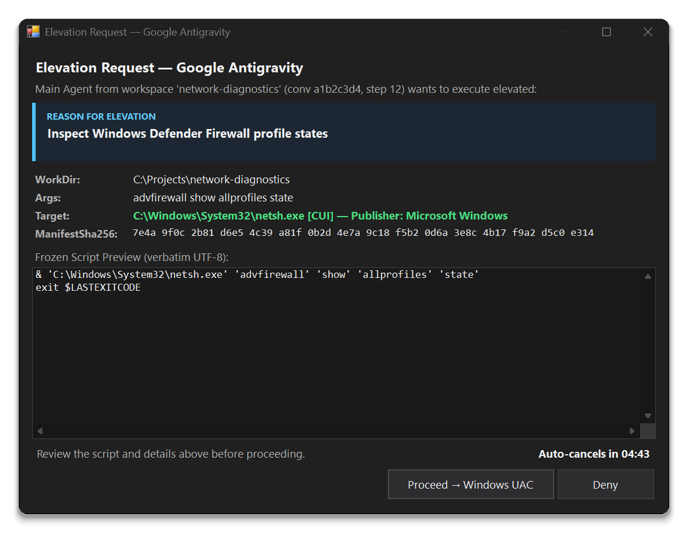
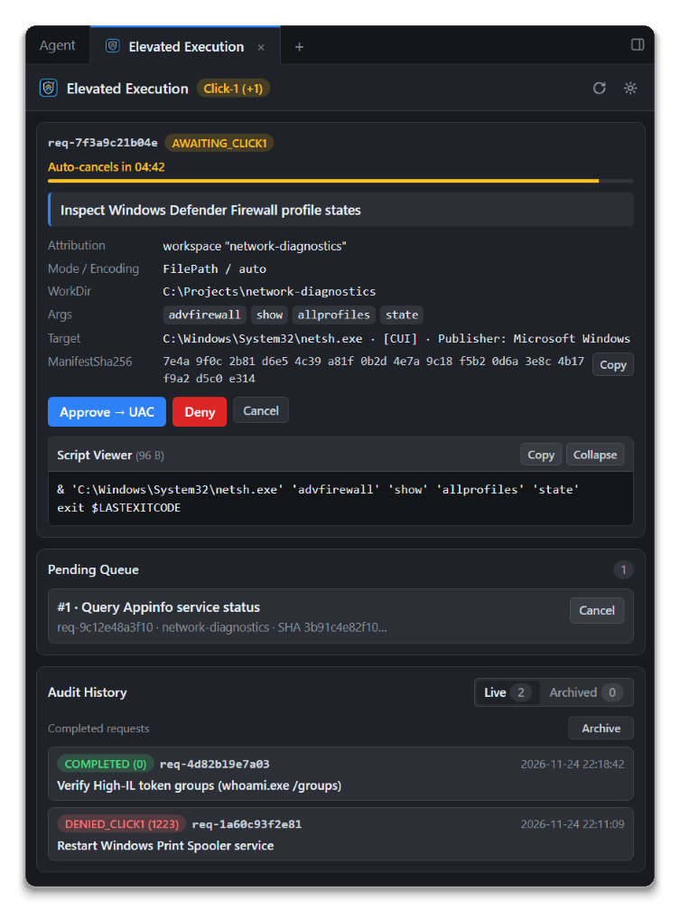
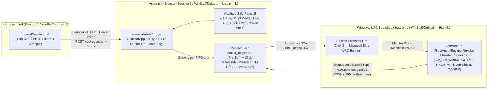

# Antigravity-ElevatedExecution (`elevated-exec`)

Desktop- and RDP-accessible **two-click UAC elevation** for **Google Antigravity** on Windows, built as a native Antigravity Sidecar plugin (`elevated-exec`) paired with a single immutable High-IL PowerShell 5.1 runner (`C:\Program Files\AgentElevation\Invoke-ElevatedRunner.ps1`).

<p align="center">
  <picture>
    <source media="(prefers-color-scheme: dark)" srcset="assets/modal-dark.png">
    <source media="(prefers-color-scheme: light)" srcset="assets/modal-light.png">
    
  </picture>
  <br>
  <em>Click-1 Confirmation Dialog (PerMonitorV2 DPI-aware, synced with Windows Light / Dark / High Contrast themes)</em>
</p>

<p align="center">
  <picture>
    <source media="(prefers-color-scheme: dark)" srcset="assets/panel-dark.png">
    <source media="(prefers-color-scheme: light)" srcset="assets/panel-light.png">
    
  </picture>
  <br>
  <em>Elevated Execution Auxiliary Side Pane (active request inspector, FIFO queue, and Live audit history)</em>
</p>

---

## Why This Exists

In Google Antigravity on Windows, `run_command` executes in interactive Session 1 on ephemeral hidden Win32 desktops (`WinSta0\exebox-*`). Calling `Start-Process -Verb RunAs` directly from `run_command` causes `consent.exe` to render invisibly on the hidden desktop when `PromptOnSecureDesktop = 0` (or fail on desktop mismatch when `= 1`), hanging the command and leaking orphaned UAC prompts.

Antigravity sidecars, however, run unsandboxed directly on **`WinSta0\Default`**. **`elevated-exec`** bridges `run_command` to `WinSta0\Default` safely without weakening Windows OS boundaries (`PromptOnSecureDesktop = 0` and `fDenyTSConnections = 1` remain untouched):

1. **Thin CLI Client ([`tools/Invoke-Elevated.ps1`](tools/Invoke-Elevated.ps1))**: Invoked from `run_command` via `$HOME\.gemini\config\plugins\elevated-exec\tools\Invoke-Elevated.ps1`. Validates parameters, local paths, and PE subsystems, then submits requests over authenticated loopback HTTP (`127.0.0.1:<port>`) and streams SSE events (`POST /ipc/requests`).
2. **Medium-IL Sidecar Broker & Auxiliary Side Pane ([`sidecars/broker/`](sidecars/broker/))**: Node.js ESM `SidecarApp` (`elevated-exec/broker`) + per-request `broker_helper.ps1` running on `WinSta0\Default`. Atomically writes a 256-bit hex bearer token to `%ANTIGRAVITY_EXECUTABLE_DATA_DIR%\runtime.json` (fallback `%USERPROFILE%\.gemini\antigravity\sidecar_data\elevated-exec\broker\data\runtime.json`), freezes each manifest `{ script, args, workDir, encoding }` (`1 B..10 MiB`) to `DATA_DIR\staged\<requestId>.json` with `ManifestSha256`, enforces a strict 1-by-1 FIFO queue, runs the `< 4 s` desktop/WTS/ACL pre-flight gate, displays system-themed Click-1 and Queue Reminder modals, launches `ShellExecuteExW("runas")` on an STA thread, and hosts a hardened output-only Named Pipe server.
3. **Unified High-IL Runner ([`runner/Invoke-ElevatedRunner.ps1`](runner/Invoke-ElevatedRunner.ps1))**: Deployed once by an Administrator via [`Install-ElevationRunner.ps1`](Install-ElevationRunner.ps1) into immutable `C:\Program Files\AgentElevation\`. Validates hardened directories before loading inline C#, authenticates the broker helper over the Named Pipe, performs a single-read `ManifestSha256` verification, runs child PowerShell 5.1 inside a Win32 Job Object with `HKLM`-locked `PATH`/`PATHEXT`/`PSModulePath`, isolated `C:\ProgramData\AgentElevation\tmp\<runId>\`, interactive `CONIN$`, and per-line/idle-flush `zh-CN` CP936/UTF-8/UTF-16LE streaming.

---

## Architecture



### Security & Trust Boundary

- **OS-Enforced Privilege Boundary**:
  - Windows UAC (Click 2) + immutable `C:\Program Files\AgentElevation\Invoke-ElevatedRunner.ps1` (`Owner = Administrators`, inheritance disabled, `SYSTEM:F`, `Administrators:F`, `Users:RX`, zero reparse points).
  - Admin-only `C:\ProgramData\AgentElevation\` and `C:\ProgramData\AgentElevation\tmp\` (`Owner = Administrators`, inheritance disabled, `SYSTEM:F` and `Administrators:F` only, zero reparse points; sweeps stale `> 24 h` run dirs while preserving `last-error.log`).
  - Hardened output-only Named Pipe (`ag-elev-<32-hex-GUID>`, `65536`-byte input buffer, exact SDDL `D:P(D;;0x1f019f;;;NU)(A;;0x100000;;;OW)(A;;0x1f019f;;;SY)(A;;0x12019b;;;BA)`).
  - High-IL runner authenticates the pipe server via `GetNamedPipeServerProcessId` + `OpenProcess` + `GetProcessTimes` against `CallerPid`/`CallerStart`, validates the frozen manifest in a single read (`FileShare.Read`) against UAC-passed `ManifestSha256` (`1205` on mismatch), validates `workDir`, writes `tmp\<runId>\script.ps1` verbatim with UTF-8 BOM, locks `PATH`/`PATHEXT` from `HKLM` and `PSModulePath` to system defaults, isolates `TEMP`/`TMP` to `tmp\<runId>\`, and runs child PowerShell 5.1 inside a Win32 Job Object (created without `JOB_OBJECT_LIMIT_KILL_ON_JOB_CLOSE`).
- **Desktop Pre-Flight Gate (`< 4 s`) & `Win+L` Fail-Fast (`1202`)**:
  - Executed synchronously on request arrival (`HTTP 409`), before Click 1, and before `ShellExecuteExW("runas")`.
  - Verifies `SessionId != 0`, `WinSta0`, `GetThreadDesktop() == "Default"`, `WTSActive`, `WTSSessionInfoEx.SessionFlags == 1` (`0` = `Win+L` lock `WTS_SESSIONSTATE_LOCK` fails fast with `1202`), `OpenInputDesktop() == "Default"` (catches Secure Desktop), and `Test-RunnerPathSecurity` (`1204`).
- **Disconnect, Cancellation & Detach Semantics**:
  - Client disconnect (`res.on('close')`) while `QUEUED`, `AWAITING_CLICK1`, or `AWAITING_UAC` cancels (`1201`) and immediately disposes the Named Pipe so any late UAC approval aborts before script execution.
  - Disconnect while `RUNNING` **detaches** safely (`Detached` badge) so OS/driver changes are not left half-applied; explicit Side Panel **`Kill Process Tree`** closes the pipe and calls `TerminateJobObject` (`1207`) on the full child/grandchild tree.

---

## Interactive Modals & System Theme Support

- **Click-1 Modal (`"Elevation Request — Google Antigravity"`)**:
  - `PerMonitorV2` DPI-aware modal displaying attribution, prominent left-accented `-Reason` callout banner, Authenticode publisher status, `ManifestSha256`, and a `64 KB`-capped script preview.
  - Orthogonal countdown synced in UTC lockstep with the Side Panel (`300 s` default, `0` = no timeout), `300 ms` Proceed anti-misclick guard, and explicit **`Proceed → Windows UAC`** and **`Deny`** controls.
- **Queue Reminder Modal (`"Pending Elevation Queue — Google Antigravity"`)**:
  - Non-stacking, DPI auto-sized modal with a single **`Dismiss`** button and an explicit note that it closes automatically when the active task finishes or the queue clears.
  - Scheduled by the broker via a **one-shot `setTimeout`** when a job is `RUNNING` and `queue.length > 0`; re-arms for a fresh full `reminderIntervalSeconds` (`300 s` default, `0` = off) **only after** the previous reminder is dismissed (`[Dismiss]` or Side Panel `dismiss-reminder`).
- **Windows System Theme Support**:
  - Checks `SystemInformation.HighContrast` first (preserving native `SystemColors` for accessibility); otherwise reads `HKCU\Software\Microsoft\Windows\CurrentVersion\Themes\Personalize\AppsUseLightTheme` (`0` = Dark, `1`/absent = Light) and `HKCU\Software\Microsoft\Windows\DWM\AccentColor` (ABGR-to-RGB `-Reason` accent stripe, falling back to `#007ACC` Light / `#4CC2FF` Dark).
  - Dark mode applies native `dwmapi.dll` `DwmSetWindowAttribute(20/19)` dark title bars, `#202020`/`#1A1A1A`/`#F3F3F3` surfaces, brighter readable Target publisher colors, `FlatStyle.Flat` buttons, `uxtheme.dll` `SetWindowTheme("DarkMode_Explorer")` dark scrollbars, and a `1 px` `BorderStyle.None` preview wrapper.

---

## Prerequisites

- **Windows 10 / 11** with **Windows PowerShell 5.1**.
- **Google Antigravity** (provides the Auxiliary Side Pane host and bundled Node runtime via `agy-node.cmd`).
- **One-time Administrator UAC** to run `Install-ElevationRunner.ps1`.

---

## Installation & Registration

### Step 1 — Register the Plugin (Non-Elevated)

From the repository root, run `Register-Plugin.ps1` to copy the plugin bundle (including `skills\elevated-execution\SKILL.md` and `tools\Invoke-Elevated.ps1`) into `$HOME\.gemini\config\plugins\elevated-exec\` and stamp `sidecars\broker\sidecar.json` (`ELEVATED_EXEC_SYNCED_AT`):

```powershell
powershell.exe -NoProfile -ExecutionPolicy Bypass -File .\Register-Plugin.ps1
```

- **Automatic skill ingestion**: No separate skill installation step is required. Antigravity automatically discovers `skills/<name>/SKILL.md` inside any enabled global plugin under `~/.gemini/config/plugins/` via progressive disclosure (`name` and `description` are exposed to agents automatically, and the full `SKILL.md` loads on demand).
- *(Pass `-LinkSource` during active worktree development to point `sidecar.json` directly at the checkout's `sidecars/broker/main.mjs`.)*

### Step 2 — One-Time Elevated Runner Bootstrap (Administrator PowerShell)

Open an **Administrator** Windows PowerShell 5.1 prompt once and run:

```powershell
powershell.exe -NoProfile -ExecutionPolicy Bypass -File .\Install-ElevationRunner.ps1
```

This creates and hardens `C:\Program Files\AgentElevation\` and `C:\ProgramData\AgentElevation\tmp\`, deploys and unblocks `Invoke-ElevatedRunner.ps1`, and verifies raw-SID ACLs and reparse-point safety. *(Optionally pass `-StaleConsentPid <pid>` to attempt reaping a previously leaked `consent.exe` process.)*

---

## Usage in Antigravity & PowerShell

### 1. Auxiliary Side Pane (`[Elevated Execution](sidecar://elevated-exec/broker/)`)

Open the panel from the Auxiliary Side Pane `+` menu (**Elevated Execution**) or surface `[Elevated Execution](sidecar://elevated-exec/broker/)` in chat.

| UI Control | Behavior |
| :--- | :--- |
| **Active Job & Pending Queue** | Inspect the active request and strictly serialized FIFO queue (`QUEUED`, `AWAITING_CLICK1`, `AWAITING_UAC`, `RUNNING`, `DETACHED`), including `-Reason`, attribution, mode/encoding/`NormalWindow`, `-WorkDir`, `-ArgumentList` chips, target Authenticode publisher, and `ManifestSha256`. |
| **`Approve → UAC` / `Deny` / `Cancel`** | Mirror Click-1 approval (with foreground handoff + WinRT Toast fallback) or denial from the Side Panel, or cancel queued/pending requests. |
| **`Kill Process Tree`** | Disposes the Named Pipe on a `RUNNING` task so the runner calls `TerminateJobObject` on the full child/grandchild tree (`OUTCOME=KILLED`, exit `1207`). |
| **Live Output** | Streams live UTF-8 stdout/stderr (`512 KB` ring buffer) with `Follow` toggle. |
| **Audit History (`Live` \| `Archived`)** | **`Live` tab**: up to 50 recent completed `<details>` entries (`4 KB` preview/tail caps) with a 2-click `1.5 s` receding-bar **`Archive`** button (`250 ms` anti-double-click guard; disabled at `0`; reverts on timeout/`Escape`/pane-hide/`blur`) that packages `audit.jsonl` in-process via `node:zlib` into `DATA_DIR\archives\audit-<timestamp>-<hex>.zip` (leaving ongoing/queued jobs intact).<br>**Unified Auto-Rotation**: at `200` lines or `5 MB`, `appendAuditRecord()` uses the same pure in-process PKZIP writer to archive `audit.jsonl` into `DATA_DIR\archives\audit-*.zip`, atomically truncates `audit.jsonl`, resets live cache, and refreshes the **`Archived`** picker over SSE (zero loose `audit.*.jsonl` files).<br>**`Archived` tab**: newest-first **`<select>` Archive Picker** + **`Open Folder`** button (`explorer.exe` on `DATA_DIR\archives\`), reading `.zip` entries in-process via `node:zlib` (STORE/DEFLATE, CRC-32 check, `<= 16 MiB` anti-zip-bomb guard, strict `^audit-[A-Za-z0-9._-]+\.zip$` & non-reparse containment) with the shared `<details>` renderer isolated from SSE refreshes. |
| **Settings** | Configure `click1TimeoutSeconds` (default `300 s`, `0` = no timeout) and `reminderIntervalSeconds` (default `300 s`, `0` = off). |

### 2. Client CLI (`Invoke-Elevated.ps1`)

Invoke via `$HOME\.gemini\config\plugins\elevated-exec\tools\Invoke-Elevated.ps1`. All **4 parameter sets** require mandatory **`-Reason`** and accept optional **`-WorkDir`**, **`-Encoding <auto|utf8|oem|utf16>`** (default `auto`), and **`-NormalWindow`**. The argument-array parameter on `ScriptFile` and `FilePath` is **`-ArgumentList`** (not `-Args`), and there is **no `-NoWait` switch**:

```powershell
# 1. ScriptBlock (default; literal source text, no outer-scope variable capture)
& "$HOME\.gemini\config\plugins\elevated-exec\tools\Invoke-Elevated.ps1" `
    -ScriptBlock {
        sc.exe query Appinfo
        exit $LASTEXITCODE
    } `
    -Reason "Inspect Appinfo service status"

# 2. ScriptText
& "$HOME\.gemini\config\plugins\elevated-exec\tools\Invoke-Elevated.ps1" `
    -ScriptText "netsh.exe advfirewall show allprofiles state`r`nexit `$LASTEXITCODE" `
    -Reason "Check Windows Firewall profile states"

# 3. ScriptFile (self-contained .ps1; supports UTF-8 with or without BOM)
& "$HOME\.gemini\config\plugins\elevated-exec\tools\Invoke-Elevated.ps1" `
    -ScriptFile "C:\Path\To\Configure-Driver.ps1" `
    -ArgumentList @("-DriverName", "ExampleDriver") `
    -Reason "Run driver configuration script"

# 4. FilePath convenience wrapper (.exe, .com, .msc, .cpl, .msi only)
& "$HOME\.gemini\config\plugins\elevated-exec\tools\Invoke-Elevated.ps1" `
    -FilePath "C:\Windows\System32\whoami.exe" `
    -ArgumentList @("/groups") `
    -Reason "Verify High-IL token groups"
```

#### `-FilePath` Allowlist, Path Hardening & Encoding Rules (`1206` `INVALID_ARGS`)

- **Extension Allowlist**: Only `.exe`, `.com`, `.msc`, `.cpl`, and `.msi` are accepted. `.ps1` is rejected with guidance to use `-ScriptFile`; `.bat`, `.cmd`, `.lnk`, directories, and missing targets fail with `1206`.
- **Unqualified Lookup**: Names without `\`, `/`, or `X:` resolve strictly from `System32` and `HKLM` `PATH` (never `-WorkDir` or CWD), probing `HKLM` `PATHEXT` plus `.MSC;.CPL;.MSI`.
- **PE Subsystem Handling**: `.exe`/`.com` CUI (`3`) binaries stream live stdout/stderr (`& $path ...; exit $LASTEXITCODE`); GUI (`2`), `.msc`, `.cpl`, and `.msi` (`System32\msiexec.exe /i`) targets run via `Start-Process -Wait -PassThru` and propagate `$p.ExitCode`.
- **Rejected Paths**: UNC paths (`\\...`, `//...`), Win32/NT device paths (`\\?\...`, `\\.\...`, `\??\...`), URI schemes (`scheme://`, `scheme:...`, `::`), non-`FileSystem` PowerShell providers, and `Network`/`Unknown` drive types are rejected with `1206` across `-WorkDir`, `-ScriptFile`, `-FilePath`, and relative CWD.
- **UTF-8 BOM vs. BOM-less `-ScriptFile`**: `Read-ScriptFileStrict` handles UTF-8 BOM (`EF BB BF`) and UTF-16LE/BE BOMs automatically, and validates BOM-less `.ps1` files as strict UTF-8 under `-Encoding auto`/`utf8` (`1206` on invalid UTF-8 bytes; use `-Encoding oem` for CP936 files). The runner writes `script.ps1` with a UTF-8 BOM for PS 5.1 compatibility.

---

## Exit Codes & Outcome Contract

Every CLI invocation emits `ELEVATION_PENDING: <requestId>` once accepted and finishes with a deterministic status line:

```text
[elevated-exec] OUTCOME=<OUTCOME> EXIT=<int32>
```

| Exit Code | Outcome | Meaning |
| :--- | :--- | :--- |
| `0` *(or child `Int32`)* | `COMPLETED` | Script or wrapped executable finished; `EXIT` is the exact `Int32` exit code. |
| `1201` | `CANCELLED` | Request cancelled prior to execution (`QUEUED`, `AWAITING_CLICK1`, `AWAITING_UAC`). |
| `1202` | `SESSION_NOT_INTERACTIVE` | Session locked (`Win+L`), disconnected, non-`WinSta0\Default`, or Secure Desktop active. |
| `1203` | `SIDECAR_UNAVAILABLE` | Broker not running, `runtime.json` missing/stale, or unexpected SSE disconnect. |
| `1204` | `RUNNER_INVALID` / `RUNNER_PRECONNECT_EXIT` | Runner ACL/owner/reparse check failed or runner exited before pipe handshake. |
| `1205` | `SHA256_MISMATCH` | Frozen manifest SHA-256 verification failed inside High-IL runner. |
| `1206` | `INVALID_ARGS` | Invalid parameter, disallowed `-FilePath` extension/UNC/device/URI/dir, or invalid UTF-8 file. |
| `1207` | `KILLED` | Running task terminated via Side Panel **`Kill Process Tree`** (`TerminateJobObject`). |
| `1223` | `DENIED_CLICK1` / `DENIED_UAC` | User denied Click-1 modal/panel or clicked **No** on Windows UAC. |
| `1460` | `TIMEOUT_CLICK1` | Click-1 confirmation countdown expired before approval. |

---

## Programmatic Verification Suite (Non-Elevated)

Run the full non-elevated programmatic test suite from the repository root:

```powershell
powershell.exe -NoProfile -ExecutionPolicy Bypass -File .\tests\Run-ProgrammaticChecks.ps1 -RepoRoot (Get-Location).Path
powershell.exe -NoProfile -ExecutionPolicy Bypass -File .\tests\Run-ProgrammaticChecks.ps1 -SelfTest
```

*(The Node.js broker IPC / SSE / PKZIP archive & auto-rotation suite in `tests\Test-BrokerIpc.mjs` is invoked automatically by `Run-ProgrammaticChecks.ps1` via Antigravity's `agy-node.cmd` with `--import=<sidecar_sdk/register_loader.js>`.)*

---

## PowerShell 5.1 Nuances & Troubleshooting

- **Always end scripts with `exit $LASTEXITCODE`**: Under `powershell.exe -File`, a failing native binary does not update the script exit code unless propagated explicitly.
- **`CONOUT$` interactive prompts**: `Read-Host`, `Read-Host -AsSecureString`, and `-Confirm` write directly to `CONOUT$` rather than stdout/stderr; restore the minimized taskbar PowerShell window to answer them.
- **Native UTF-8 output capture**: Assigning UTF-8 command output to a PowerShell variable (`$out = netsh.exe ...`) decodes using CP936 in PS 5.1; let UTF-8 native tools stream directly to stdout.
- **Locked/disconnected errors (`1202`)**: Unlock the Windows console/RDP session on `WinSta0\Default` and ensure no Secure Desktop prompt is active.
- **Sidecar unavailable (`1203`)**: Confirm `elevated-exec` is enabled in Antigravity Customizations (`runtime.json` present) or re-run `Register-Plugin.ps1`.
- **Pre-connect runner failures (`1204`)**: Inspect the admin-only forensic log `C:\ProgramData\AgentElevation\tmp\last-error.log` from an Administrator prompt, or re-run `Install-ElevationRunner.ps1`.

---

## Repository Layout

```text
Antigravity-ElevatedExecution/
├── LICENSE                                  # MIT License
├── plugin.json                              # Antigravity plugin manifest ("name": "elevated-exec")
├── README.md                                # Architecture, security, UI, CLI, tests, and troubleshooting docs
├── TODO.md                                  # Optional future enhancements (High-IL immutable audit log)
├── Register-Plugin.ps1                      # Installs plugin bundle and stamps sidecar.json
├── Install-ElevationRunner.ps1              # One-time Admin bootstrap for Program Files & ProgramData
├── assets/
│   ├── logo.svg                             # High-contrast plugin icon
│   ├── modal-dark.png                       # Click-1 modal screenshot (Dark theme)
│   ├── modal-light.png                      # Click-1 modal screenshot (Light theme)
│   ├── panel-dark.png                       # Auxiliary Side Pane screenshot (Dark theme)
│   └── panel-light.png                      # Auxiliary Side Pane screenshot (Light theme)
├── runner/
│   └── Invoke-ElevatedRunner.ps1            # High-IL PS 5.1 unified runner (UTF-8 BOM)
├── sidecars/
│   └── broker/
│       ├── sidecar.json                     # Sidecar manifest (SIDECAR_UI_ENTRYPOINT_AUX_PANE)
│       ├── package.json                     # Node ESM config ("type": "module")
│       ├── main.mjs                         # SidecarApp, FIFO queue, loopback IPC, ZIP audit & rotation
│       ├── broker_helper.ps1                # Pre-flight, themed Click-1/Reminder modals, STA UAC, pipe server
│       ├── index.html                       # Auxiliary Side Pane HTML
│       ├── styles.css                       # Antigravity theme-aware styles
│       └── app.js                           # Live queue/viewer/output/config & Live/Archived audit UI
├── skills/
│   └── elevated-execution/
│       └── SKILL.md                         # Antigravity agent skill & sidecar:// pill
├── tests/
│   ├── Run-ProgrammaticChecks.ps1           # Aggregated non-elevated programmatic test runner
│   ├── Test-EncodingAndSyntax.ps1           # BOM, UTF-8, PS 5.1 AST, JSON & node --check validation
│   ├── Test-ManifestAndSecurity.ps1         # Manifest SHA-256, ACL/reparse, DPI & WinForms theme tests
│   ├── Test-CliAndSubsystem.ps1             # CLI arg/path hardening (UNC/device/URI) & PE subsystem tests
│   ├── Test-Decoder.ps1                     # Per-line / idle-flush CP936/UTF-8/UTF-16LE decoder tests
│   ├── Test-BrokerIpc.mjs                   # Loopback HTTP/SSE IPC, FIFO/Reminder, ZIP archive & rotation tests
│   └── Test-CrossFeatureAndWorkloads.ps1    # Cross-component workload & integration checks
└── tools/
    └── Invoke-Elevated.ps1                  # Thin CLI client & -FilePath PE wrapper (UTF-8 BOM)
```

---

## Future Enhancements

See [`TODO.md`](TODO.md) for optional future enhancements under consideration — including an Admin-hardened **High-IL Immutable Execution Audit Log** (`C:\ProgramData\AgentElevation\audit\exec-audit.jsonl`, `Users:RX`, `SYSTEM:F`, `Administrators:F`) that preserves tamper-proof records of executed elevated runs while keeping the Medium-IL Side Panel `Live`/`Archived` workflow zero-UAC.
